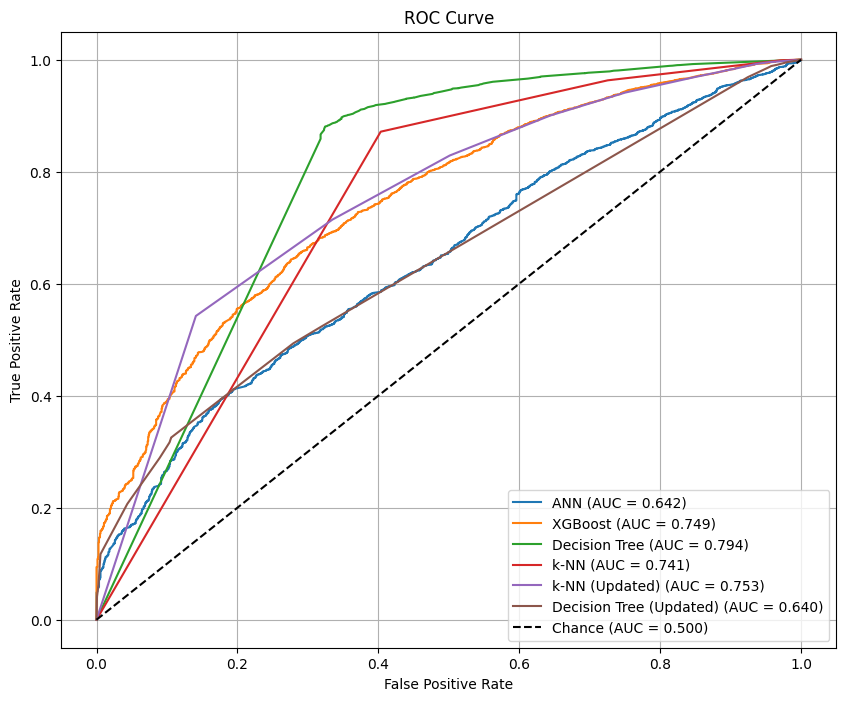
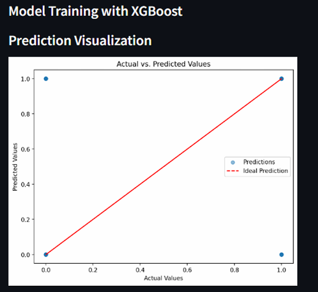
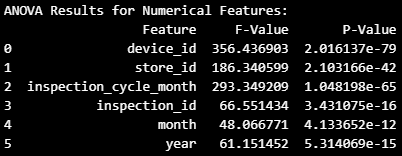
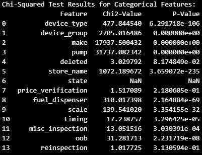

# Predictive Analysis of Device Inspection Outcomes

## 📌 Project Background
Regulatory inspections are critical for safety and compliance, but they are often reactive and resource-intensive. This project—a collaborative machine learning initiative for a fictional consulting firm (PredictX)—aims to transition inspections from reactive to proactive by predicting whether a device will **Pass or Fail** an inspection.

By identifying high-risk devices in advance, regulators can prioritize their resources, reducing downtime and operational costs.

##  Objectives
1. Develop predictive models to forecast inspection outcomes.
2. Evaluate model performance (ANN, kNN, Decision Tree, XGBoost) using metrics like ROC-AUC, precision, recall, and F1-score.
3. Deploy the best-performing model into an interactive Streamlit web application for end-users.

##  Tech Stack
- **Data Processing:** Pandas, NumPy, Scikit-learn
- **Machine Learning:** TensorFlow/Keras (ANN), XGBoost, Scikit-learn (Decision Tree, kNN)
- **Imbalance Handling:** Imbalanced-learn (SMOTE)
- **Deployment:** Streamlit
- **Visualization:** Matplotlib, Seaborn

##  Methodology & Challenges Overcome
1. **Data Integration:** Merged three relational tables (Devices, Stores, Inspections) using primary/foreign keys.
2. **Preprocessing:** Handled missing values via mean/mode imputation, removed outliers using IQR, and applied Label Encoding and Standard Scaling.
3. **Feature Selection:** Used **ANOVA** for numerical features and **Chi-Squared** tests for categorical features to drop statistically insignificant variables.
4. **Handling Extreme Class Imbalance:** The dataset had a severe 96:4 imbalance (164,490 Pass vs 6,824 Fail). I applied **SMOTE (Synthetic Minority Over-sampling Technique)** to balance the training data, preventing the model from simply predicting the majority class.
5. **Model Comparison:** Trained and tuned four models. The Decision Tree achieved the highest ROC-AUC (0.810), while XGBoost was ultimately selected for deployment due to its robustness and alignment with actual results.

##  Interactive Dashboard (Streamlit)
I deployed the model using Streamlit, allowing users to:
- Upload a cleaned CSV dataset.
- Explore data distributions and detect outliers via boxplots.
- Run the machine learning pipeline (encoding, SMOTE, scaling) with a single click.
- View actual vs. predicted values and download the results.

## 📈 Visual Highlights

### 1. Handling Extreme Class Imbalance (SMOTE)

*The original dataset had a severe 96:4 imbalance. SMOTE was applied to the training data to ensure the model could actually learn the characteristics of a failing device.*

### 2. Model Evaluation (ROC Curve)

*Comparing the performance of ANN, kNN, Decision Tree, and XGBoost. The Decision Tree achieved the highest AUC (0.810), proving strong discriminative ability.*

### 3. Streamlit Deployment (GUI)

*The final model was deployed into a Streamlit web app, allowing users to upload a CSV, run preprocessing, and view predictions without writing any code.*

### 4. Statistical Feature Selection

*Used ANOVA (for numerical features) and Chi-Squared tests (for categorical features) to drop statistically insignificant variables before modeling.*

## 🚀 How to Run
1. Install dependencies: `pip install -r requirements.txt`
2. Run the Streamlit app: `streamlit run app.py`

---
*Group Project for BSD3523 Machine Learning, UMPSA (PredictX Team)*
